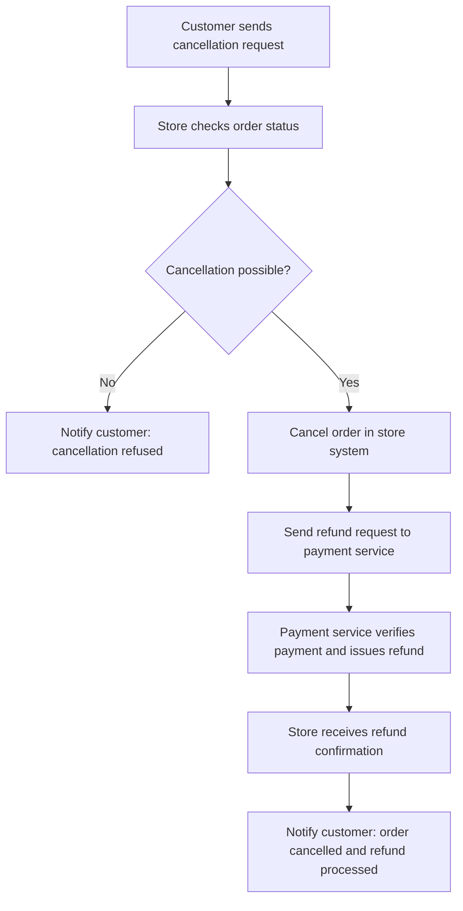

# Online Order Cancellation — BPMN 2.0

**Business process modelling · Educational portfolio project · October 2026**

## Process at a glance

## Project overview

This project models an online-store order cancellation and refund workflow using **BPMN 2.0**. The objective is to make the decision logic and collaboration between participants explicit: the store checks order eligibility, either refuses the request or cancels the order, and coordinates a refund before informing the customer.

**Business problem:** cancellation requests must be processed consistently, including when cancellation is no longer possible and when a refund must be issued through a separate payment service.

## Participants and responsibilities

| Participant | Responsibility |
| --- | --- |
| Customer | Initiates cancellation and receives the outcome |
| Online store | Receives the request, checks eligibility, cancels the order when possible, and communicates with the customer and payment service |
| Payment service | Receives the refund request, checks the payment, completes the refund, and sends confirmation |

The source image shows **three visible participant processes (white-box pools)** with cross-participant **message flows**. The online store contains the main decision logic with an **exclusive (XOR) gateway**.

## Paths through the process

1. **Cancellation not possible:** after checking order status, the store takes the `No` route and notifies the customer of the refusal.
2. **Cancellation possible:** the store cancels the order, requests a refund from the payment service, receives refund confirmation, and notifies the customer that the cancellation and refund have been processed.

The model focuses on these **two outcomes**. It does not model a separate refund-failure, partial-refund, or timeout/escalation scenario.

## Repository files

- The original educational diagram is available in the downloadable project ZIP; the editable reconstruction and process summary are published here.
- [`models/order-cancellation-process.bpmn`](models/order-cancellation-process.bpmn) — an **editable BPMN 2.0 XML reconstruction** based on the original image; open it in a BPMN-compatible editor. This simplified XML focuses on process semantics and does not contain graphical BPMN-DI coordinates.

> The editable XML is a reconstruction from the image, **not an original exported source file**. Certain connective details were made explicit for importability and should not be confused with a verbatim original export.

## Techniques demonstrated

- Identifying participants, boundaries, tasks, and messages
- Modelling mutually exclusive outcomes with an XOR gateway
- Separating sequence flows (inside a process) from message flows (between participants)
- Coordinating an external refund process
- Communicating an analytical model through a diagram and reproducible source

## Potential extensions

- Add refund failure and retry handling
- Model cancellation policy via order status and cutoff windows
- Add SLA measurements and exception monitoring
- Define process owners and RACI responsibilities

## Author

Nikita Buribaev · MiBA, Graduate School of Management, Saint Petersburg State University